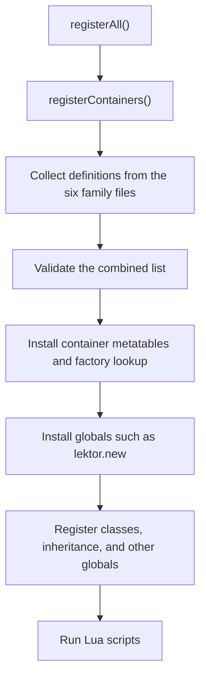

# How container registration works

Each supported container type has one definition that describes how Lua should use it. Individual class bindings use that description when exposing a field or accepting an argument.

The files under `src/Lua/Containers/` are ordinary C++ source and header files. The word **catalog** means the collection of container definitions stored there.

This document explains how the pieces connect. The [catalog contributor guide](../src/Lua/Containers/README.md) contains the detailed rules for adding or changing a binding. The [containers reference](ContainersReference.md) describes the Lua API.

## Three separate steps

| Step | What happens | When |
| --- | --- | --- |
| Describe a type | Choose its C++ wrapper, Lua name, element conversion, and optional factory. | In the source code. |
| Register that type | Install its methods, type identity, and factory lookup into a Lua state. | When the bindings are initialized. |
| Create a container | Allocate an actual container that can hold elements. | When Lua calls a factory such as `lektor.new("Character*")`. |

Registering `lektor<Character*>` makes that type available. Creating one allocates a particular list of character pointers. Many lists can use the same registration.

A **metatable** is the Lua table that connects a container userdata to its operations and identifies its type. A **factory** is the function that creates a new container.

## Where the code lives

| File or group | Responsibility |
| --- | --- |
| [RegisterBindings.cpp](../src/Lua/RegisterBindings.cpp) | Starts registration of containers, classes, inheritance, and globals. |
| [RegisterContainers.cpp](../src/Lua/RegisterContainers.cpp) | Collects all container definitions, asks for them to be registered, and installs the factory globals. |
| [ContainerBinding.h](../src/Lua/ContainerBinding.h) | Declares the common definition record and the `KENSHILUA_DEFINE_CONTAINER` macro. |
| [ContainerBinding.cpp](../src/Lua/ContainerBinding.cpp) | Checks for conflicts and maintains each Lua state's registration and factory lookup. |
| `Containers/*Types.h` | Gives names to the exact C++ helper specializations used by a family of containers. |
| `Containers/Register*.cpp` | Describes those types and lists which definitions should be registered. |
| [CommonTypes.h](../src/Lua/Containers/CommonTypes.h) | Shares several detailed C++ specializations between registration files and class bindings. |
| Helper headers, such as [LektorBinding.h](../src/Bindings/Kenshi/Util/LektorBinding.h) | Implement indexing, iteration, insertion, removal, creation, and cleanup. |
| Individual class binding files | Expose the class's fields and methods, using the registered container types. |

The family files are paired as follows:

| Family | C++ aliases | Definitions and collection |
| --- | --- | --- |
| Lektors | [LektorTypes.h](../src/Lua/Containers/LektorTypes.h) | [RegisterLektor.cpp](../src/Lua/Containers/RegisterLektor.cpp) |
| Standard maps, sets, and deques | [StdContainersTypes.h](../src/Lua/Containers/StdContainersTypes.h) | [RegisterStdContainers.cpp](../src/Lua/Containers/RegisterStdContainers.cpp) |
| Ogre unordered maps and sets | [OgreUnorderedTypes.h](../src/Lua/Containers/OgreUnorderedTypes.h) | [RegisterOgreUnordered.cpp](../src/Lua/Containers/RegisterOgreUnordered.cpp) |
| Boost unordered containers | [BoostContainersTypes.h](../src/Lua/Containers/BoostContainersTypes.h) | [RegisterBoostContainers.cpp](../src/Lua/Containers/RegisterBoostContainers.cpp) |
| Arrays and TagsClass | [ArraysTypes.h](../src/Lua/Containers/ArraysTypes.h) | [RegisterArrays.cpp](../src/Lua/Containers/RegisterArrays.cpp) |
| Fitness selectors | [FitnessSelectorsTypes.h](../src/Lua/Containers/FitnessSelectorsTypes.h) | [RegisterFitnessSelectors.cpp](../src/Lua/Containers/RegisterFitnessSelectors.cpp) |

## Follow one type: a list of character pointers

### 1. Give the C++ wrapper a name

`LektorTypes.h` contains:

```cpp
typedef LektorPtrBinding<Character*> LektorPtr_CharacterPtrBinding;
```

This says: use the pointer-list helper for `Character*` elements. The typedef gives that specialization a name that the registration file can reuse. The underlying container is still `lektor<Character*>`.

This declaration alone does not install anything in Lua or allocate a list.

### 2. Describe its Lua binding

`RegisterLektor.cpp` contains this entry:

```cpp
KENSHILUA_DEFINE_CONTAINER(Containers::LektorPtr_CharacterPtrBinding,
    "lektor<Character*>",
    CharacterBinding::getMetatableName(), NULL, NULL,
    (ContainerFactoryDefinition("lektor",
        Containers::LektorPtr_CharacterPtrBinding::createNew,
        LektorPtr_CharacterPtrBindingFactories)))
```

Read it as:

| Part | Meaning |
| --- | --- |
| `LektorPtr_CharacterPtrBinding` | The C++ helper specialization to use. |
| `"lektor<Character*>"` | The metatable name identifying this container type. |
| `CharacterBinding::getMetatableName()` | How the helper recognizes and exposes character elements. |
| The two `NULL` values | This helper needs no additional conversion hints in those slots. |
| `"lektor"` | The factory family through which this type can be created. |
| `createNew` | The helper function that allocates a new list. |
| The `Factories` array | Additional lookup names that select this same constructor. |

The macro creates a record called `ContainerBindingDefinition` and defines the helper's fixed name and conversion metadata. That record also includes the full C++ type identities, the registration function, and the source filename for error messages.

Other helpers interpret the three metadata slots according to their needs. A map can use them for key and value conversion; a primitive list may need none. `ContainerFactoryDefinition()` with no arguments means that the entry provides no factory.

### 3. Add the definition to the startup list

Near the bottom of `RegisterLektor.cpp`, `collectLektor` contains:

```cpp
definitions.push_back(&containerBindingDefinition<
    Containers::LektorPtr_CharacterPtrBinding::MetadataType>());
```

`containerBindingDefinition<...>()` retrieves the record created by the macro. The collector adds its address to the list that startup will process. It does not create a character list.

The macro describes the binding; the collector makes that description reachable from startup. Both pieces are needed.

### 4. Install the type into Lua

`RegisterContainers.cpp` calls all six collectors and passes the combined list to `registerContainerBindings`.

`ContainerBinding.cpp` first checks the list for conflicts. It then calls each definition's registration function. For this example, that function comes from `LektorBinding.h`, which installs the list's Lua operations.

The relevant startup order is:



The container metatables are installed before class registration finishes. Scripts run after those stages, when the element class bindings are also available.

### 5. Create and use an actual list

Given an existing character userdata named `character`, Lua can do:

```lua
local characters = lektor.new("Character*")
characters:push(character)
print(characters:size())
```

`lektor.new` resolves the requested name using the current Lua state's factory lookup, then calls the stored `createNew` function. The result wraps a newly allocated native `lektor<Character*>`. String requests preserve `*`: a value name requests values and a pointer name requests pointers. Class-table and userdata shortcuts require an unambiguous element type; see the [factory type contract](ContainersReference.md#explicit-factory-types).

The `push` and `size` operations come from the generic helper in `LektorBinding.h`. A bound SDK method expecting this container type can extract that same native list through the helper's `getInstance` function.

## What the longer C++ names mean

Three names appear throughout the registration code:

| Name | Meaning in the character-list example |
| --- | --- |
| `ContainerType` | The actual SDK container: `lektor<Character*>`. |
| The binding type | The helper that supplies Lua operations and its pointer/value/access policy. |
| `MetadataType` | The helper layer that holds the fixed name and conversion slots. |

Some helpers share behavior through inheritance. For example, the writable lektor helper builds on a base that implements reading and stores the metadata. `MetadataType` lets those layers find the same definition. It does not introduce another native container type.

## Why there are checks and a private registry

If two bindings registered the same container with different metadata, a metatable could already exist while a later registration changed the helper's conversion settings, and the resulting behavior would depend on registration order.

The checks compare the metatable name, complete C++ type, helper policy, conversion metadata, and factory aliases. Two incompatible definitions produce a startup error identifying the conflict. Identical repeated registration preserves the existing metatable. Checking the complete list first catches these conflicts before installing its public metatables and factories.

The checks use C++ runtime type information, or RTTI, to distinguish full specializations. Allocators, comparators, hashes, and predicates are part of that identity.

Each Lua state keeps its own lookup in a private table in Lua's registry. The table records which definitions are installed and which constructors factory names select. It also records the unique element types available through class-table and userdata shortcuts, marking shared value/pointer cases as ambiguous. The fixed C++ definitions are shared; installation records and factory lookup belong to the individual state. Creating a temporary Lua state therefore leaves the live state's lookup intact.

## Why some aliases are in CommonTypes.h

`CommonTypes.h` shares six detailed specializations with their class binding consumers. For example, a map using `std::allocator` must use the same specialization everywhere, even though the generic map helper defaults to an Ogre allocator.

These aliases can largely use forward declarations. Keeping them here lets consumers reuse the exact types without including the full SDK dependencies of a family header. Their actual registration entries remain in the appropriate family `.cpp` files.

## Ownership

Registration does not affect ownership: engine fields are borrowed, factory-created wrappers are Lua-owned, and pointer elements refer to borrowed game objects. See [Architecture, Ownership, and Memory Rules](ContainersReference.md#architecture-ownership-and-memory-rules).

## Finding the right file for a change

| What you want to change | Start here |
| --- | --- |
| A container's Lua operations | Its generic helper header. |
| The exact C++ specialization | Its family `*Types.h`, or `CommonTypes.h` for a shared alias. |
| Its metatable name, conversion metadata, or factory aliases | Its entry in the family `Register*.cpp`. |
| Whether the definition is included at startup | The family's collector and `RegisterContainers.cpp`. |
| A class property or SDK method accepting a container | That class's binding file. |
| Conflict detection or factory lookup storage | `ContainerBinding.cpp`. |

For a concrete starting point, read the character alias in `LektorTypes.h`, its macro entry and collector entry in `RegisterLektor.cpp`, and then the short `registerContainers` function. Those show the complete path from a supported C++ type to a registered Lua container.
