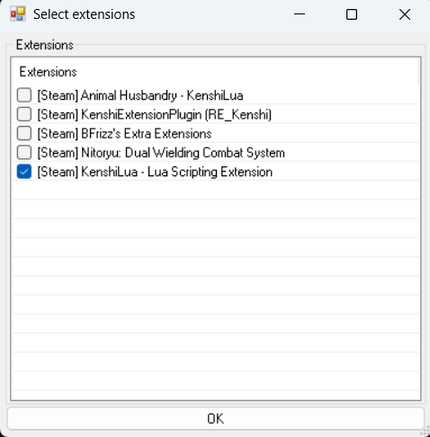
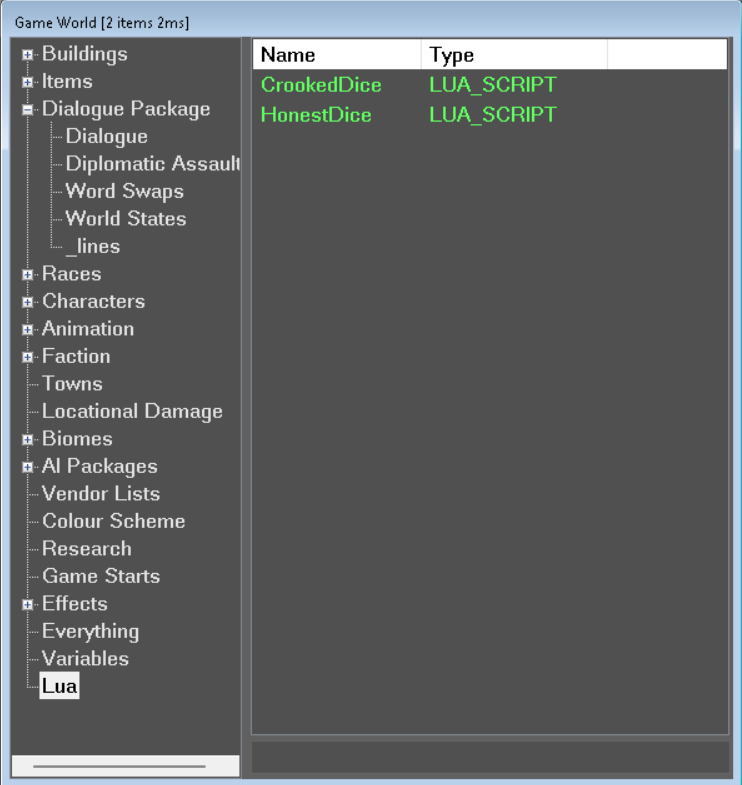
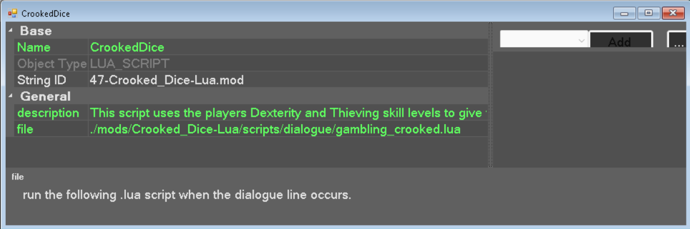
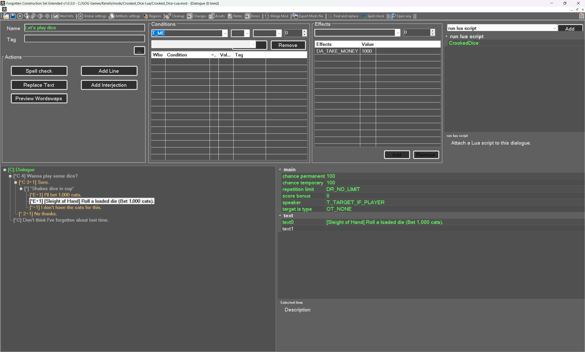
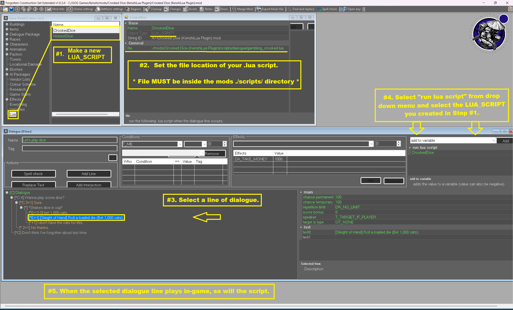

# Dialogue Scripting Guide

The **`DialogueScriptBridge`** is a subsystem within KenshiLua that links Kenshi's Forgotten Construction Set (FCS) dialogue system directly to external Lua scripts. This allows modders to execute custom Lua scripts whenever specific dialogue lines play in-game.

This guide includes the complete FCS setup, from enabling the KenshiLua extension and creating a `LUA_SCRIPT` item to attaching it to a piece of dialogue. The [World State Scripting Guide](WorldStateScriptingBridge.md) covers the separate workflow for scripts triggered by world-state changes.

---

## Overview & Architecture

When a dialogue line is uttered in Kenshi, the game calls `Dialogue::_doActions(thisptr, dialogLine)`. KenshiLua hooks this method via `DialogueScriptBridge`:

```text
+------------------+       Dialogue Played       +------------------------+
| Kenshi Engine    | --------------------------> | Dialogue::_doActions   |
+------------------+                             +------------------------+
                                                             |
                                                       (Hooked Call)
                                                             v
                                                 +------------------------+
                                                 | DialogueScriptBridge   |
                                                 +------------------------+
                                                             |
                                      Reads "run lua script" | Reference
                                                             v
                                                 +------------------------+
                                                 | LUA_SCRIPT GameData    |
                                                 | (Type 322, file field) |
                                                 +------------------------+
                                                             |
                                       Resolves path & sets  | globals
                                                             v
                                                 +------------------------+
                                                 | Executes .lua Script   |
                                                 | currentDialogue        |
                                                 | currentDialogueLine    |
                                                 +------------------------+
```

### Execution Steps

1. **Hook Interception**: After Kenshi processes the line's normal actions in `Dialogue::_doActions`, `DialogueScriptBridge` is invoked.
2. **GameData Reference Lookup**: Inspects `dialogLine->data` for reference lists labeled `"run lua script"`.
3. **Script Item Resolution**: For each reference found, resolves the target `GameData` item of type `322` (`LUA_SCRIPT`) and extracts its `"file"` string attribute.
4. **Path Resolution**: `ScriptLoader` resolves the mod-qualified path that FCS stores in the `file` field, such as `./mods/My Mod/scripts/dialogue/example.lua`.
5. **Global Injections**: Sets two transient global variables in the Lua state:
   - `currentDialogue` (`Dialogue*`)
   - `currentDialogueLine` (`DialogLineData*`)
6. **Sandboxed Execution**: Executes the target `.lua` script in a sandboxed environment.
7. **Cleanup**: Restores the previous values of `currentDialogue` and `currentDialogueLine`. They are normally `nil`; restoring instead of blindly clearing them keeps an outer script's context intact when one dialogue action triggers another.

---

## FCS Setup

Dialogue scripting requires **FCS Extended** with its KenshiLua extension enabled:

- [FCS Extended on GitHub](https://github.com/BFrizzleFoShizzle/FCS_extended)
- [FCS Extended on Nexus Mods](https://www.nexusmods.com/kenshi/mods/1825)

When FCS Extended displays its **Select extensions** window, enable **KenshiLua - Lua Scripting Extension**, then open your `.mod` file.



The extension applies KenshiLua's [`fcs.def`](../assets/config/fcs.def), which:

- Registers `LUA_SCRIPT` as item type `322` (also available to Lua as `itemType.LUA_SCRIPT`).
- Adds a **Lua** category to the GameWorld tree.
- Gives each `LUA_SCRIPT` item a script file field and a description field.
- Adds the `run lua script` reference list to `DIALOGUE`, `DIALOGUE_LINE`, and `WORD_SWAPS` items.

### Creating a `LUA_SCRIPT` Item

1. Open FCS Extended with the mod you want to edit marked as active.
2. In the **GameWorld** tree, select the new **Lua** category.
3. Right-click in the item list and create a new item. The resulting object's type is `LUA_SCRIPT`.



4. Give the item a descriptive name. FCS normally assigns a mod-specific string ID such as `10-MyMod.mod`; you may change it, but every `LUA_SCRIPT` item must have a unique string ID. If two loaded items use the same ID, the later mod can replace the earlier item before KenshiLua resolves the reference.
5. Set the item's fields:
   - **`description`**: Optional notes describing what the script does.
   - **`file`**: Select the `.lua` file that this item should run.



Select a file under an active provider mod's `scripts/` directory. The provider may be the mod you are editing or another active dependency mod. FCS stores a mod-qualified path such as `./mods/Shared Framework/scripts/dialogue/example.lua`, so copying a `LUA_SCRIPT` item into a dependent mod can preserve its reference to the provider's file.

Any subdirectory beneath `scripts/` is valid; `scripts/dialogue/` is the recommended convention for dialogue-triggered scripts.

### Attaching a Script to Dialogue

1. Open the target `DIALOGUE`, `DIALOGUE_LINE`, or `WORD_SWAPS` item in FCS Extended.
2. In the reference drop-down at the upper right, select **`run lua script`** and click **Add**.
3. Select the `LUA_SCRIPT` item you created.
4. Save your `.mod` file.



You may attach multiple `LUA_SCRIPT` items to one piece of dialogue. Each referenced script runs in reference-list order whenever Kenshi processes that dialogue item's actions.

### Complete FCS Workflow

The annotated overview below shows the complete setup: create the `LUA_SCRIPT` item, select its file, open the target dialogue item, and attach the script.



---

## Directory & File Conventions

Kenshi organizes mod files under the standard path:

```text
./Kenshi/mods/<mod_name>/
```

Keep Lua scripts inside an active provider mod's `scripts/` subdirectory. A `LUA_SCRIPT` item in one mod may point to a file supplied by another active dependency mod.

KenshiLua resolves active Steam mods from both the game's `mods/` directory and Steam's `steamapps/workshop/content/233860/<workshop-id>/` directory. It matches each directory to an active mod by its `.mod` descriptor instead of loading every subscribed Workshop item.

```text
./Kenshi/mods/<mod_name>/scripts/
```

Use `scripts/` as the standard location for mod Lua files. Automatic discovery and relative Lua imports use this directory. The current FCS entry-script resolver checks containment against the active provider's mod directory, so it does not enforce `scripts/` containment for the entry file.

### Recommended Directory Structure

```text
./Kenshi/mods/examplemod/
├── examplemod.mod
└── scripts/
    ├── init/
    │   └── 00_startup.lua        -- Executed automatically on startup (main menu load)
    └── dialogue/
        ├── guard_bribe.lua       -- Dialogue script for guard bribe line
        ├── recruit_custom.lua    -- Dialogue script for custom recruit line
        └── quest_trigger.lua     -- Dialogue script triggering a world state/quest
```

---

## When the Script Runs

### Startup Scripts

Scripts under `scripts/init/` run automatically when KenshiLua initializes at the main menu, before a save game is loaded. Use them to register event handlers, create widgets, or define shared state that should remain available for the session.

### Triggered Scripts

Dialogue scripts run after Kenshi processes the linked line's normal actions through `Dialogue::_doActions`.

- Each script runs every time the linked line's actions execute. Attaching a script does not make it run at startup or when a save is loaded.
- Multiple scripts run in reference-list order. Dialogue references do not use the numeric run modes used by world states.
- Scripts execute only on KenshiLua's Lua owner thread. A worker-thread call is skipped.
- `scripts/dialogue/` is a folder convention; the `run lua script` reference determines when the file runs.

Before the same triggered file runs again, KenshiLua unregisters event handlers and destroys MyGUI widgets created by its previous run. Put handlers or widgets that must remain for the whole session in a `scripts/init/` script instead.

---

## Runtime Environment

During the execution of a dialogue script, the following globals are made available:

| Global Variable | Type | Description |
| :--- | :--- | :--- |
| `currentDialogue` | [`Dialogue`](BindingsReference.md#dialogue) | Active Kenshi `Dialogue` instance. |
| `currentDialogueLine` | [`DialogLineData`](BindingsReference.md#dialoglinedata) | Active `DialogLineData` instance being processed. |

Both globals are set only while the script runs and return to their previous values afterward, normally `nil`. Scripts run on KenshiLua's Lua owner thread.

### Sandbox & Shared State

Each script runs in its own sandbox environment. Reading a name falls through to the shared globals, but a plain assignment such as `MyMod = {}` creates the name only inside that script's sandbox. Other scripts and the KenshiLua console cannot see it.

To share state, assign it to the global table explicitly:

```lua
_G.MyMod = _G.MyMod or {}
```

### Loading Other Lua Files

Scripts can load another file from their provider mod without knowing the Kenshi installation path or mod directory name:

```lua
local settings = require("config.settings") -- scripts/config/settings.lua
local values = dofile("config/values.lua")   -- scripts/config/values.lua
local chunk = assert(loadfile("config/tasks.lua"))
chunk()
```

All relative paths start at the executing script's provider mod's `scripts/` directory, even when another mod supplied the `LUA_SCRIPT` item. `require` accepts a Lua module name and checks `<module>.lua` before `<module>/init.lua`; it does not scan directories recursively. `dofile` and `loadfile` accept an exact path relative to `scripts/`. Required mod modules execute in the calling script's sandbox and are cached within that sandbox.

Modules shipped in KenshiLua's `lib/` directory use ordinary `require`:

```lua
local Layout = require("mygui.layout")
```

To load Lua files from a different provider during script execution, name that provider explicitly. Both its active mod name and `.mod` descriptor filename are accepted:

```lua
local api = KenshiLua.requireFromMod("Shared Framework.mod", "api.shared")
local values = KenshiLua.dofileFromMod("Shared Framework.mod", "api/values.lua")
local task = assert(KenshiLua.loadfileFromMod("Shared Framework.mod", "api/task.lua"))
task()
```

Cross-mod paths are confined to the provider's `scripts/` directory and never search active mods by load order. Provider modules run in a shared provider environment, so their nested `require("internal.helper")` calls resolve against the provider mod. `requireFromMod` caches modules by provider and module name; script reloads clear this provider cache. A missing or inactive provider produces an explicit error, while `loadfileFromMod` follows `loadfile` convention by returning `nil, error`.


### Example Lua Script (`scripts/dialogue/guard_bribe.lua`)

```lua
-- Guard Bribe Script
-- Triggered via 'run lua script' reference on a dialogue line

if not currentDialogue or not currentDialogueLine then
    print("[Guard Bribe] Warning: Dialogue context missing.")
    return
end

-- Retrieve speaker and target characters from currentDialogue
local speaker = currentDialogue.speaker -- Character object
local target = currentDialogue.target   -- Character object

if speaker and target then
    local speakerName = speaker:getName()
    local targetName = target:getName()

    print(string.format("[DialogueScript] %s is speaking to %s", speakerName, targetName))

    -- Perform custom Lua logic (e.g., check player money, modify stats, spawn items)
    local playerFaction = target.faction
    if playerFaction then
        print("[DialogueScript] Target Faction: " .. tostring(playerFaction.name))
    end
end
```

---

## Diagnostics & Troubleshooting

KenshiLua provides a built-in diagnostic function to inspect and verify all `run lua script` references registered in memory across all active mod `GameData` items. It reports missing targets, targets that are not `LUA_SCRIPT` items, and missing or empty `file` fields.

### Scanning Script References in Lua

You can call `KenshiLua.checkLuaScriptReferences()` from the debug console or an `init` script:

```lua
local report = KenshiLua.checkLuaScriptReferences()
print(report)
```

### Example Diagnostic Output

```text
--- Scanning GameData for 'run lua script' references ---
Total GameData items in mainList: 14205

- Item Type: 4 ("1534-gamedata.mod" / "Guard Bribe Line 1")
    Reference ID: "322-my_mod.mod"
      -> Lua script file: "./mods/My Mod/scripts/dialogue/guard_bribe.lua"

Total items with 'run lua script' references: 1
--- Scan Complete ---
```

### Common Issues & Checklist

1. **Script Path Errors**: Select a `.lua` file inside an active provider mod's `scripts/` directory. The provider may be the mod containing the `LUA_SCRIPT` item or another active dependency. FCS stores the mod-qualified path in the `file` field; `KenshiLua.checkLuaScriptReferences()` shows the exact stored value.
2. **Missing FCS Extended Config**: Ensure FCS Extended is configured properly with `fcs.def` containing `LUA_SCRIPT` (Type ID `322`).
3. **Nil Globals Outside the Script**: `currentDialogue` and `currentDialogueLine` are **only** valid during the synchronous execution of the dialogue line script. Afterward, each global returns to the value it had before the script, which is normally `nil`.
