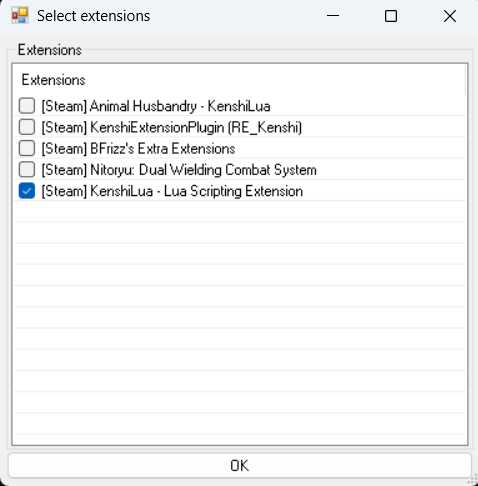
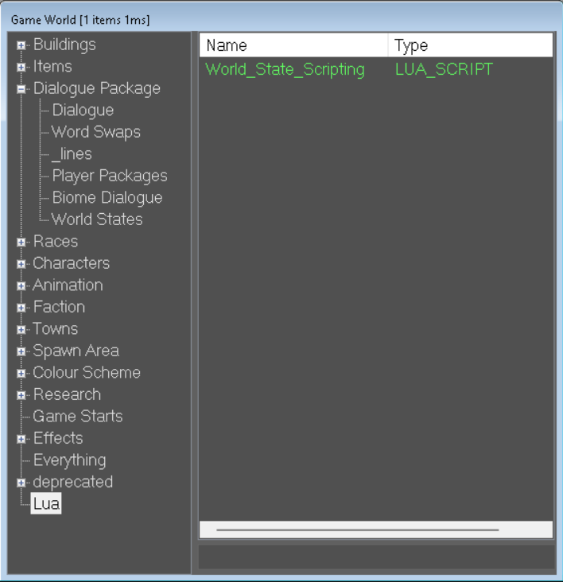
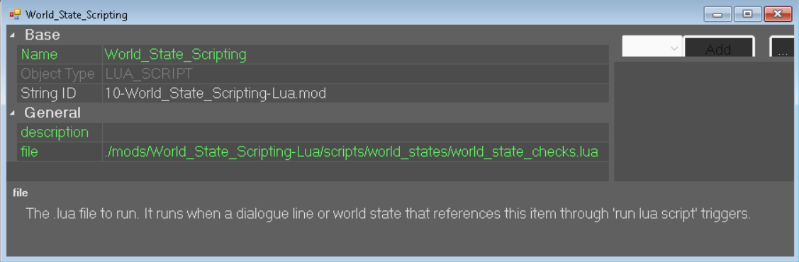
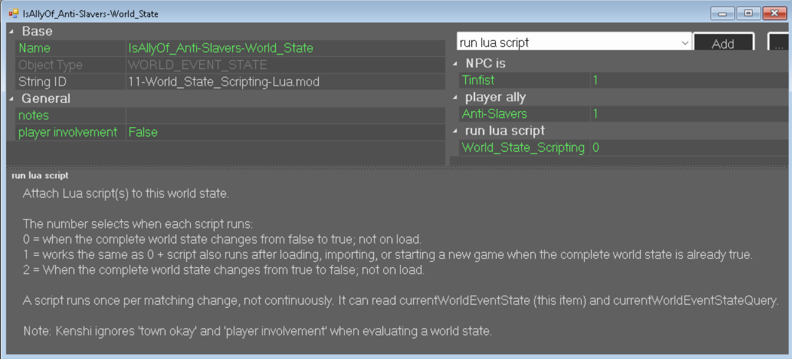
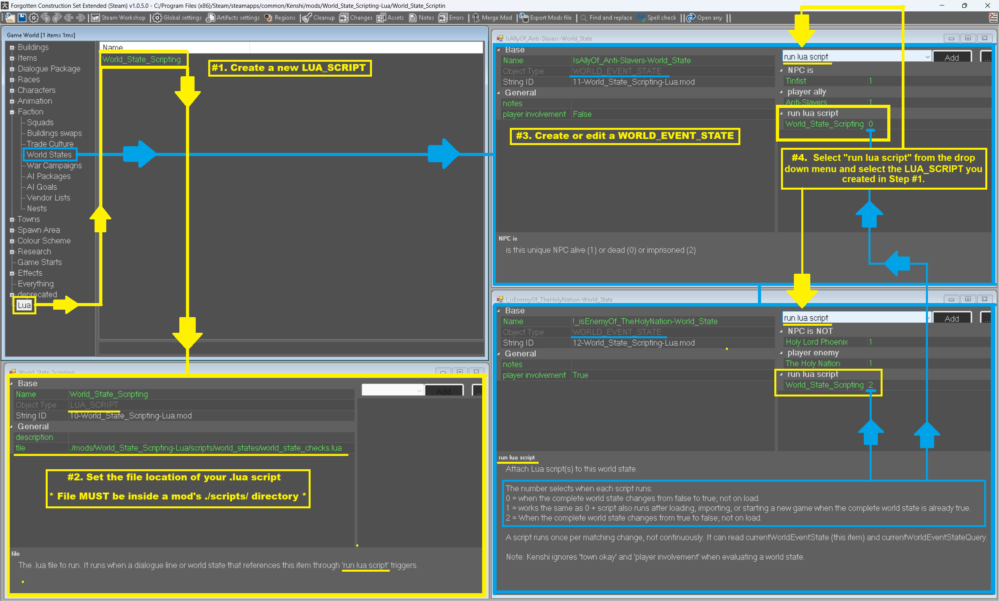

# World State Scripting Guide

The **`WorldStateScriptBridge`** is a subsystem within KenshiLua that runs Lua scripts when a Forgotten Construction Set (FCS) `WORLD_EVENT_STATE` changes between true and false. A world state can carry one or more `run lua script` references, and each reference selects when its script runs.

This guide includes the complete FCS setup, from enabling the KenshiLua extension and creating a `LUA_SCRIPT` item to attaching it to a world state. The [Dialogue Scripting Guide](DialogueScriptingBridge.md) covers the separate workflow for dialogue-triggered scripts.

---

## Overview & Architecture

Kenshi only evaluates a world state when a dialogue condition, campaign, or town asks for it. KenshiLua instead checks every `WORLD_EVENT_STATE` that has a `run lua script` reference after each unpaused game update, so a script does not depend on anything else referencing the world state.

```text
+------------------+     Unpaused game update     +-------------------------------+
| Kenshi Engine    | ---------------------------> | GameWorld::charsUpdate        |
+------------------+                              +-------------------------------+
                                                                  |
                                                            (Hooked Call)
                                                                  v
                                                  +-------------------------------+
                                                  | WorldStateScriptBridge        |
                                                  +-------------------------------+
                                                                  |
                                  WorldEventStateQuery::isTrue()  | for each watched state
                                                                  v
                                                  +-------------------------------+
                                                  | Result changed?               |
                                                  | Run scripts whose mode        |
                                                  | matches the change            |
                                                  +-------------------------------+
                                                                  |
                                            Resolves path & sets  | globals
                                                                  v
                                                  +-------------------------------+
                                                  | Executes .lua Script          |
                                                  | currentWorldEventState        |
                                                  | currentWorldEventStateQuery   |
                                                  +-------------------------------+
```

### Execution Steps

1. **Baseline**: On the first unpaused update after KenshiLua starts, and after every load, import, or new game (`GameWorld::resetGame`), the bridge collects each `WORLD_EVENT_STATE` with `run lua script` references and records whether its complete state is true.
2. **Update Check**: On each later unpaused `GameWorld::charsUpdate`, the bridge calls `WorldEventStateQuery::isTrue()` for every watched state and compares the result with the previous one.
3. **Script Item Resolution**: For each reference whose mode matches the change, the bridge resolves the target `GameData` item of type `322` (`LUA_SCRIPT`) and reads its `"file"` attribute.
4. **Path Resolution**: `ScriptLoader` resolves the mod-qualified path stored by FCS in the `LUA_SCRIPT` item's `file` field.
5. **Global Injections**: Sets two transient global variables in the Lua state:
   - `currentWorldEventState` (`GameData*`)
   - `currentWorldEventStateQuery` (`WorldEventStateQuery*`)
6. **Sandboxed Execution**: Executes the target `.lua` script in a sandboxed environment.
7. **Cleanup**: Restores both globals to their previous values after the script completes. They are normally `nil`.

---

## FCS Setup

World state scripting requires **FCS Extended** with its KenshiLua extension enabled:

- [FCS Extended on GitHub](https://github.com/BFrizzleFoShizzle/FCS_extended)
- [FCS Extended on Nexus Mods](https://www.nexusmods.com/kenshi/mods/1825)

When FCS Extended displays its **Select extensions** window, enable **KenshiLua - Lua Scripting Extension**, then open your `.mod` file.



The extension applies KenshiLua's [`fcs.def`](../assets/config/fcs.def), which:

- Registers `LUA_SCRIPT` as item type `322` (also available to Lua as `itemType.LUA_SCRIPT`).
- Adds a **Lua** category to the GameWorld tree.
- Gives each `LUA_SCRIPT` item a script file field and a description field.
- Adds the `run lua script` reference list to `WORLD_EVENT_STATE` items.

### Creating a `LUA_SCRIPT` Item

1. Open FCS Extended with the mod you want to edit marked as active.
2. In the **GameWorld** tree, select the new **Lua** category.
3. Right-click in the item list and create a new item. The resulting object's type is `LUA_SCRIPT`.



4. Give the item a descriptive name. FCS normally assigns a mod-specific string ID such as `10-MyMod.mod`; you may change it, but every `LUA_SCRIPT` item must have a unique string ID. If two loaded items use the same ID, the later mod can replace the earlier item before KenshiLua resolves the reference.
5. Set the item's fields:
   - **`description`**: Optional notes describing what the script does.
   - **`file`**: Select the `.lua` file that this item should run.



Select a file under an active provider mod's `scripts/` directory. The provider may be the mod you are editing or another active dependency mod. FCS stores a mod-qualified path such as `./mods/Shared Framework/scripts/worldstate/bandit_leader_dead.lua`, so copying a `LUA_SCRIPT` item into a dependent mod can preserve its reference to the provider's file.

Any subdirectory beneath `scripts/` is valid; `scripts/worldstate/` is the recommended convention for world-state-triggered scripts.

### Attaching a Script to a World State

1. In the **GameWorld** tree, open **Dialogue Package > World States** and create or edit the target `WORLD_EVENT_STATE`.
2. Configure its ordinary world-state requirements, such as `NPC is`, `NPC is NOT`, `player ally`, and `player enemy`.
3. In the reference drop-down at the upper right, select **`run lua script`** and click **Add**.
4. Select the `LUA_SCRIPT` item you created.
5. Set the number beside that reference to mode `0`, `1`, or `2`. The [When the Script Runs](#when-the-script-runs) section explains each mode.
6. Save your `.mod` file.



You may attach multiple `LUA_SCRIPT` items to one world state and give each reference its own mode.

### Complete FCS Workflow

The annotated overview below shows the complete setup: create the `LUA_SCRIPT` item, select its file, create or edit a `WORLD_EVENT_STATE`, and attach the script with the desired mode.



---

## Directory & File Conventions

Kenshi organizes mod files under the standard path:

```text
./Kenshi/mods/<mod_name>/
```

Keep Lua scripts inside an active provider mod's `scripts/` subdirectory. A `LUA_SCRIPT` item in one mod may point to a file supplied by another active dependency mod.

KenshiLua resolves active Steam mods from both the game's `mods/` directory and Steam's `steamapps/workshop/content/233860/<workshop-id>/` directory. It matches each directory to an active mod by its `.mod` descriptor instead of loading every subscribed Workshop item.

```text
./Kenshi/mods/<mod_name>/scripts/
```

Use `scripts/` as the standard location for mod Lua files. Automatic discovery and relative Lua imports use this directory. The current FCS entry-script resolver checks containment against the active provider's mod directory, so it does not enforce `scripts/` containment for the entry file.

### Recommended Directory Structure

```text
./Kenshi/mods/examplemod/
├── examplemod.mod
└── scripts/
    ├── init/
    │   └── 00_startup.lua            -- Executed automatically on startup (main menu load)
    └── worldstate/
        ├── bandit_leader_dead.lua    -- Runs on the configured bandit-leader trigger
        ├── faction_allied.lua        -- Runs on the configured alliance-state trigger
        └── faction_enemy.lua         -- Runs on the configured enemy-state trigger
```

---

## When the Script Runs

### Startup Scripts

Scripts under `scripts/init/` run automatically when KenshiLua initializes at the main menu, before a save game is loaded. Use them to register event handlers, create widgets, or define shared state that should remain available for the session.

### Triggered Scripts

Each `run lua script` reference uses its first numeric value as its mode:

| Mode | When the script runs |
| :--- | :--- |
| `0` | When the complete world state changes from false to true. It does not run on load. |
| `1` | As mode `0`, and also after loading, importing, or starting a new game when the complete world state is already true. |
| `2` | When the complete world state changes from true to false. It does not run on load. |

- A script runs once per matching change, not continuously while the state remains true or false. Multiple scripts on one world state can use different modes.
- When a state becomes true, its mode `0` scripts run before its mode `1` scripts.
- After loading a save, importing, or starting a new game, the first check records each state's current value. Only mode `1` runs during this initial check, and only when the complete state is true.
- The checks run only while the game is unpaused. A change that happens and reverts while the game is paused does not run a script.
- The result is for the complete world state. An individual requirement changing does not trigger a script unless that change also changes the complete result.
- Kenshi evaluates a world state from its `NPC is`, `NPC is NOT`, `player ally`, and `player enemy` lists. Kenshi v1.0.65 does not load the FCS `town okay` or `player involvement` fields into the query. Town requirements are not evaluated. The internal `playerInvolvement` flag is evaluated, but the engine constructor and query builder leave it uninitialized; the FCS checkbox does not reliably control that check.
- A reference with any other mode value is skipped, and KenshiLua logs an error naming the script and the world state.
- `scripts/worldstate/` is a folder convention; the `run lua script` reference and its mode determine when the file runs.

Before the same triggered file runs again, KenshiLua unregisters event handlers and destroys MyGUI widgets created by its previous run. Put handlers or widgets that must remain for the whole session in a `scripts/init/` script instead.

---

## Runtime Environment

During the execution of a world state script, the following globals are made available:

| Global Variable | Type | Description |
| :--- | :--- | :--- |
| `currentWorldEventState` | [`GameData`](BindingsReference.md#gamedata) | The `WORLD_EVENT_STATE` item whose configured script trigger occurred. |
| `currentWorldEventStateQuery` | [`WorldEventStateQuery`](BindingsReference.md#worldeventstatequery) | Kenshi's cached query for that item, as returned by `WorldEventStateQuery.getFromData`. |

Both globals are set only while the script runs and return to their previous values afterward, normally `nil`. Scripts run on KenshiLua's Lua owner thread.

### Sandbox & Shared State

Each script runs in its own sandbox environment. Reading a name falls through to the shared globals, but a plain assignment such as `MyMod = {}` creates the name only inside that script's sandbox. Other scripts and the KenshiLua console cannot see it.

To share state, assign it to the global table explicitly:

```lua
_G.MyMod = _G.MyMod or {}
```

### Loading Other Lua Files

Scripts can load another file from their provider mod without knowing the Kenshi installation path or mod directory name:

```lua
local settings = require("config.settings") -- scripts/config/settings.lua
local values = dofile("config/values.lua")   -- scripts/config/values.lua
local chunk = assert(loadfile("config/tasks.lua"))
chunk()
```

All relative paths start at the executing script's provider mod's `scripts/` directory, even when another mod supplied the `LUA_SCRIPT` item. `require` accepts a Lua module name and checks `<module>.lua` before `<module>/init.lua`; it does not scan directories recursively. `dofile` and `loadfile` accept an exact path relative to `scripts/`. Required mod modules execute in the calling script's sandbox and are cached within that sandbox.

Modules shipped in KenshiLua's `lib/` directory use ordinary `require`:

```lua
local Layout = require("mygui.layout")
```

To load Lua files from a different provider during script execution, name that provider explicitly. Both its active mod name and `.mod` descriptor filename are accepted:

```lua
local api = KenshiLua.requireFromMod("Shared Framework.mod", "api.shared")
local values = KenshiLua.dofileFromMod("Shared Framework.mod", "api/values.lua")
local task = assert(KenshiLua.loadfileFromMod("Shared Framework.mod", "api/task.lua"))
task()
```

Cross-mod paths are confined to the provider's `scripts/` directory and never search active mods by load order. Provider modules run in a shared provider environment, so their nested `require("internal.helper")` calls resolve against the provider mod. `requireFromMod` caches modules by provider and module name; script reloads clear this provider cache. A missing or inactive provider produces an explicit error, while `loadfileFromMod` follows `loadfile` convention by returning `nil, error`.


### Example Lua Script (`scripts/worldstate/bandit_leader_dead.lua`)

```lua
if not currentWorldEventState or not currentWorldEventStateQuery then
    return
end

print(string.format("[WorldState] %s is now %s",
    currentWorldEventState.name,
    tostring(currentWorldEventStateQuery:isTrue())))
```

---

## Diagnostics & Troubleshooting

KenshiLua provides a built-in diagnostic function to inspect and verify all `run lua script` references registered in memory across all active mod `GameData` items. It reports missing targets, targets that are not `LUA_SCRIPT` items, and missing or empty `file` fields.

### Scanning Script References in Lua

You can call `KenshiLua.checkLuaScriptReferences()` from the debug console or an `init` script:

```lua
local report = KenshiLua.checkLuaScriptReferences()
print(report)
```

### Example Diagnostic Output

For a `WORLD_EVENT_STATE`, the report also prints the reference's run mode before the script file:

```text
--- Scanning GameData for 'run lua script' references ---
Total GameData items in mainList: 14205

- Item Type: 110 ("12-my_mod.mod" / "Bandit leader dead")
    Reference ID: "13-my_mod.mod"
      World state run mode: 0
      -> Lua script file: "./mods/My Mod/scripts/worldstate/bandit_leader_dead.lua"

Total items with 'run lua script' references: 1
--- Scan Complete ---
```

### Common Issues & Checklist

1. **Script Path Errors**: Select a `.lua` file inside an active provider mod's `scripts/` directory. The provider may be the mod containing the `LUA_SCRIPT` item or another active dependency. FCS stores the mod-qualified path in the `file` field; `KenshiLua.checkLuaScriptReferences()` shows the exact stored value.
2. **Missing FCS Extended Config**: Ensure FCS Extended is configured properly with `fcs.def` containing `LUA_SCRIPT` (Type ID `322`).
3. **Script Never Runs**: The game must be unpaused. Confirm that the complete world state actually changes, for example by calling `WorldEventStateQuery.getFromData(gameData):isTrue()` from the console.
4. **Script Did Not Run After Load**: Only mode `1` runs when the state is already true after loading. Mode `0` waits for a change from false to true.
5. **Invalid Mode**: A mode other than `0`, `1`, or `2` is skipped and logged as an error in `KenshiLua.log`.
6. **Nil Globals Outside the Script**: `currentWorldEventState` and `currentWorldEventStateQuery` are valid only during the synchronous execution of the world state script. Afterward, each global returns to its previous value, normally `nil`.
